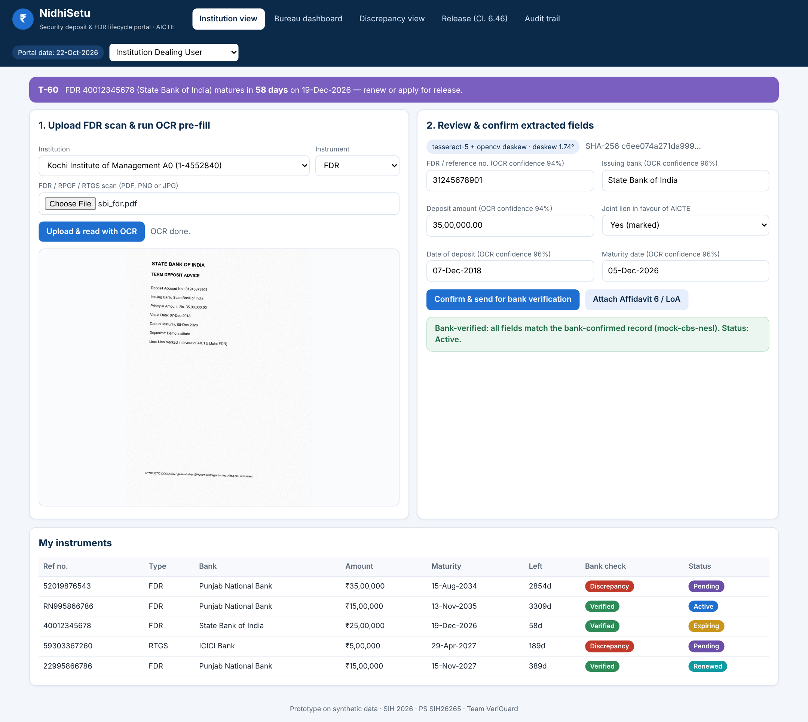
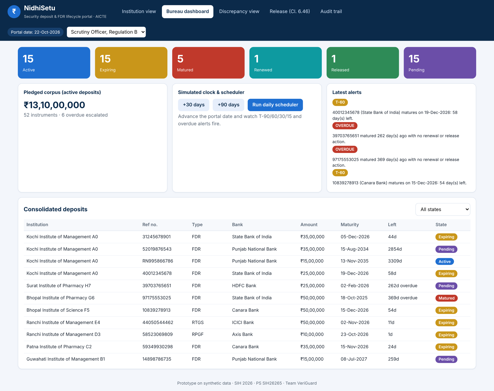
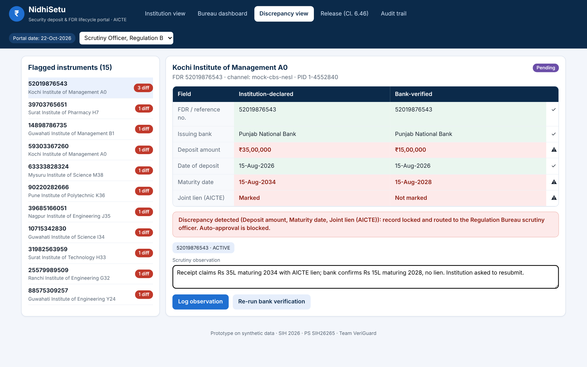
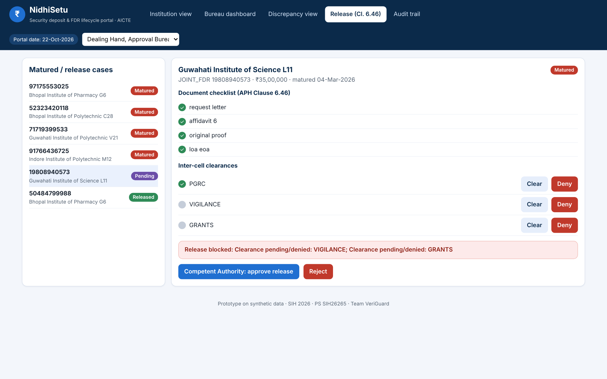
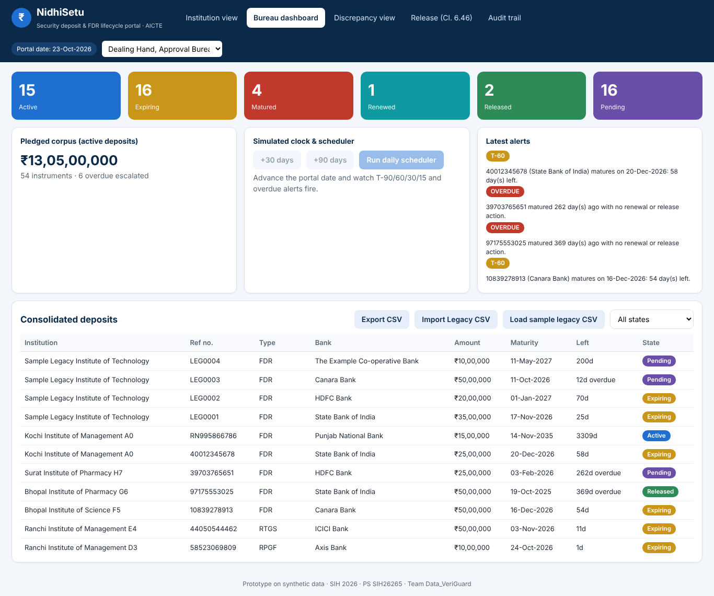
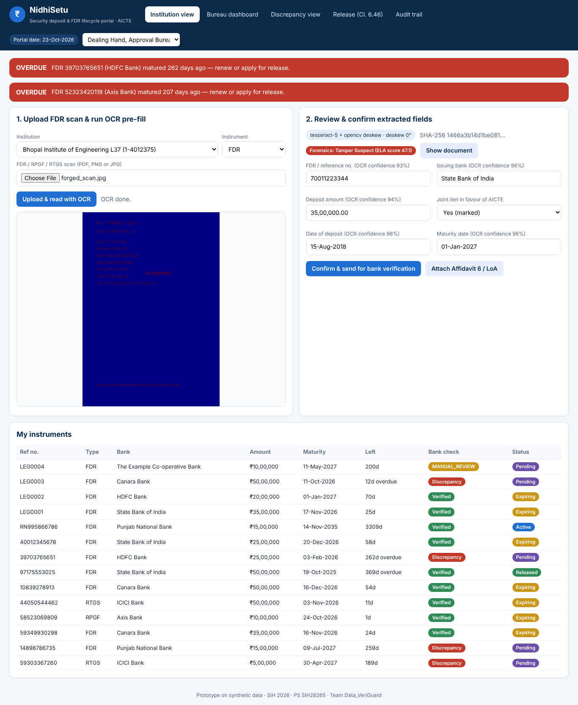
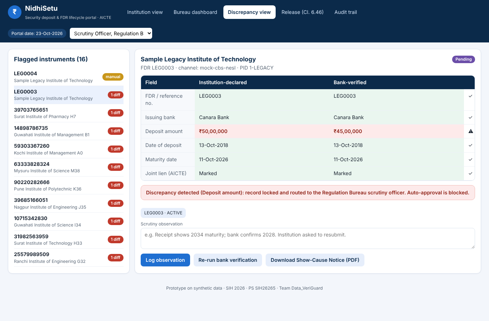
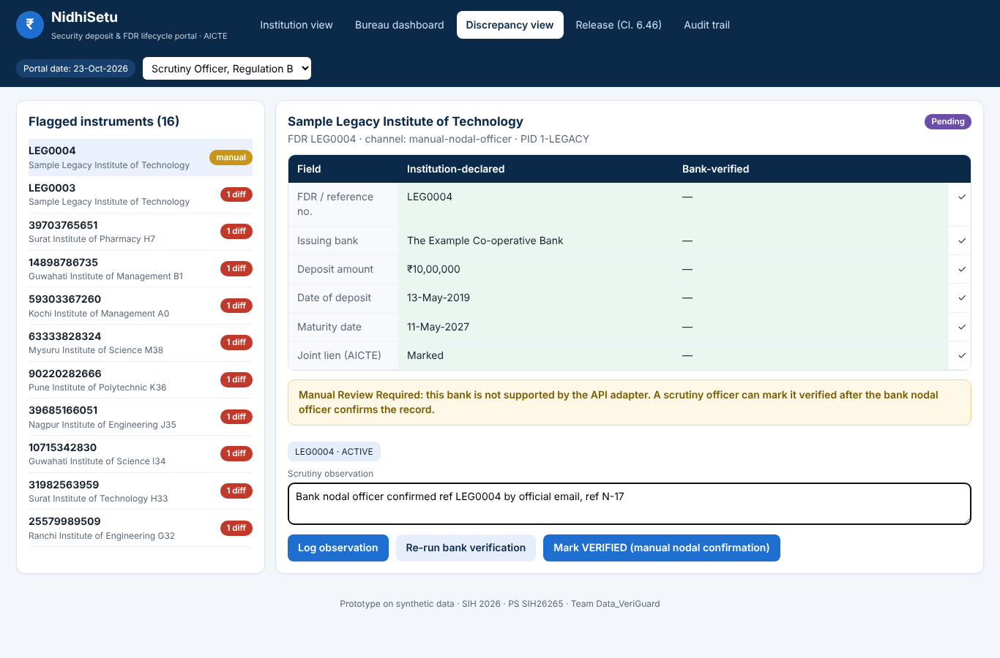
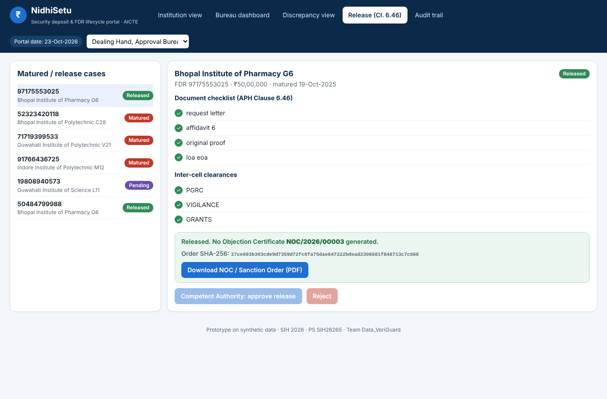
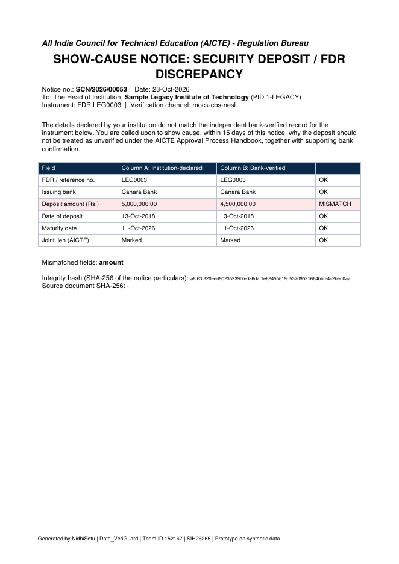

# NidhiSetu

**Bank-verified security deposit and FDR lifecycle portal for the AICTE Regulation Bureau**
Smart India Hackathon 2026 · Problem Statement **SIH26265** (Streamline of security deposit / FDR portal) · Theme: Smart Automation · Category: Software · Team **Data_VeriGuard** (ID 152167)

NidhiSetu keeps what an institution *declares* about a deposit (Column A) strictly separate from what the bank *confirms* (Column B), flags any difference, tracks maturity and renewals, and gates release/refund behind the APH Clause 6.46 checklist, with every action written to a tamper-evident audit trail.

> **Everything here runs on synthetic, fictitious data.** The bank side is a simulated CBS/NeSL adapter behind a pluggable interface; no real bank, AICTE or NeSL system is contacted.

Build progress: [PROGRESS.md](PROGRESS.md)

## Screenshots (real, captured from this prototype)

| Institution view: OCR pre-fill and confirm | Bureau dashboard |
|---|---|
|  |  |
| **Discrepancy view: declared vs bank-verified** | **Release workflow (APH Clause 6.46)** |
|  |  |

Audit trail: [docs/screenshots/05_audit_trail.png](docs/screenshots/05_audit_trail.png)

### Added features

| Bureau: CSV export and legacy import | Forensics: ELA score and tamper heatmap |
|---|---|
|  |  |
| **Discrepancy: Show-Cause Notice button** | **Manual review: mark verified after nodal confirmation** |
|  |  |
| **Release: order SHA-256 and PDF download** | **Show-Cause Notice PDF (generated)** |
|  |  |

## What is implemented (mapped to the 10 expected capabilities)

| # | Capability | Where |
|---|---|---|
| 1 | Centralised institution-wise and instrument-wise records (FDR, Joint FDR, RPGF, RTGS) | `app/models.py`, `/api/instruments` |
| 2 | Encrypted-ready document vault with SHA-256 integrity hashes, OCR pre-fill | `app/services.py`, `app/ocr.py` |
| 3 | Completeness check, bank verification, discrepancy engine | `app/services.py`, `app/bank.py`, `app/reconcile.py` |
| 4 | Validity and lock-in tracking from admin-configurable rule tables | `app/rules.py` |
| 5 | Maturity alerts T-90/60/30/15 and overdue escalation | `app/scheduler.py` |
| 6 | Rule-gated release: documents + PGRC / Vigilance / Grants clearances, then Competent Authority; NOC or Sanction Order | `app/release.py` |
| 7 | Renewal and replacement chains (Child to Parent), automatic parent suggestion | `app/services.py` (`suggest_parent`, `lineage`) |
| 8 | Consolidated dashboard (Active, Expiring, Matured, Renewed, Released, Pending) | `/api/dashboard`, `frontend/` |
| 9 | Role-based access (JWT) and hash-chained append-only audit log | `app/security.py`, `app/audit.py` |
| 10 | Pluggable bank API integration and nodal-officer webhook | `app/bank.py`, `/api/bank/webhook` |
| + | Document forensics, show-cause notice, CSV import/export, manual nodal resolution, order PDF | `app/forensics.py`, `app/notice.py`, `app/bulk.py`, `app/main.py` |

## Additional features

| Feature | Endpoint |
|---|---|
| NOC / Sanction Order PDF + SHA-256 | `GET /api/instruments/{id}/release/order-pdf`; `order_sha256` in `GET .../release` |
| Consolidated CSV export | `GET /api/instruments/export.csv` |
| Legacy CSV bulk import (audited, `instrument.bulk_import`) | `POST /api/instruments/bulk-csv` (`?sample=true` in demo mode) |
| ELA forensics heatmap and score (`ocr.forensics`) | `GET /api/instruments/{id}/ela-preview` |
| Show-Cause Notice PDF | `GET /api/instruments/{id}/discrepancy-notice.pdf` |
| Manual nodal resolution (Column A untouched) | `POST /api/instruments/{id}/manual-resolve` |

Where to find them in the UI: **Bureau dashboard** has Export CSV, Import Legacy CSV and a one-click sample import; **Institution view** shows the forensics chip and the ELA heatmap toggle after upload; **Discrepancy view** has the Show-Cause Notice download and, for unsupported banks, the manual-review resolution; **Release view** shows the order SHA-256 and the PDF download once approved.

**ELA forensics:** the first page is re-saved as JPEG (quality 90) and compared with the original; the score (0-100) measures how far the most anomalous 16 px block sits above a typical content block, and a score of 40 or more is flagged for human scrutiny. On 24 synthetic receipts, clean scans scored 15-29 and the same scans with a pasted-in amount scored 48-68. This is a screening heuristic, not calibrated on real forged documents and not proof of tampering.

## Quick start

```bash
pip install -r requirements.txt        # also needs the tesseract binary: apt install tesseract-ocr
python scripts/seed_demo.py 48         # synthetic demo data (institutions, FDRs, bank records)
scripts/run_server.sh 8000             # http://localhost:8000  (API docs at /docs)
```
Or `docker compose up --build`. Use the role selector (top right) to switch between Institution, Dealing Hand, Scrutiny Officer, Competent Authority, Bank Nodal and Admin. Passwordless demo login is on when `DEMO_MODE=1`; **set `DEMO_MODE=0` and a real `JWT_SECRET` for anything beyond a demo.**

Try the six official prototype scenarios:
1. **New FDR submission**: Institution view, upload a PDF from `data/demo_docs/pdf/`, review OCR values, confirm.
2. **Validity tracking**: Bureau dashboard shows live days-left and state per instrument.
3. **Approaching maturity**: Bureau dashboard, advance the simulated clock (+30 / +90 days) and run the scheduler.
4. **Renewal**: `POST /api/instruments/{id}/renew` with the renewed receipt; lineage is preserved.
5. **Discrepancy**: Discrepancy view shows the red side-by-side diff; the record cannot be auto-approved.
6. **Authorized release**: Release view, clear PGRC / Vigilance / Grants, then Competent Authority approves.

## Measured prototype metrics (synthetic test set)

Reproduce with `python eval/run_eval.py 150` (about 5 minutes on 2 cores). Full output: [`eval/results/METRICS.md`](eval/results/METRICS.md) and `metrics.json`. 150 synthetic receipts, 3 bank layouts, 50% clean / 30% skewed / 20% poor scans, 43 seeded discrepancies.

| Official scenario | Precision % | Recall % | FP | FN |
|---|---|---|---|---|
| 1 New FDR submission (OCR, before human confirmation) | 96.4 | 95.4 | 32 | 41 |
| 2 Validity tracking | 100.0 | 100.0 | 0 | 0 |
| 3 Approaching-maturity alerts (221 expected alerts, 130 simulated days) | 100.0 | 100.0 | 0 | 0 |
| 4 Renewal and replacement (parent suggestion) | 86.7 | 97.5 | 6 | 1 |
| 5 Discrepancy identification (after uploader confirms values) | 100.0 | 100.0 | 0 | 0 |
| 6 Authorized release gate | 100.0 | 100.0 | 0 | 0 |

Verification turnaround (upload to discrepancy verdict, one document, one CPU core): **median 3.5 s**, p95 4.5 s, dominated by OCR; rules plus bank lookup take about 10 ms. This excludes the time a human spends confirming fields.

**Read these numbers honestly**
- OCR is the weak link. On clean and skewed scans field extraction was 100%, but on poor scans precision was 85% and recall 81.5% (reference numbers and amounts are the usual casualties). That is exactly why the uploader must confirm values and why a scrutiny officer reviews flags.
- If OCR output were trusted **without** human confirmation, discrepancy precision would fall to **68.3%** (20 false flags from OCR misreads, recall still 100%). Human-in-the-loop confirmation is therefore a design requirement, not a nicety.
- Scenarios 2, 3 and 6 are rule engines evaluated against an independently computed expectation; perfect scores show the rules are implemented as specified, not that real-world data will be as clean.
- The test set is synthetic and seeded (`eval/synth.py`, seed 26265). Production numbers will differ; real bank integrations, real scan quality and real APH rule changes are not covered.

## Architecture

```
Institution upload -> OCR pre-fill (Tesseract + OpenCV deskew) -> uploader confirms (Column A)
   -> completeness check -> pluggable bank gateway (Column B) -> reconcile
        match    -> VERIFIED / Active -> maturity scheduler (T-90/60/30/15, overdue escalation)
        mismatch -> DISCREPANCY       -> scrutiny officer queue (no auto-approval)
   -> renewal (Child -> Parent)  or  release (Clause 6.46 checklist + PGRC/Vigilance/Grants) -> Competent Authority
   every step -> append-only SHA-256 hash-chained audit log
```

Stack: FastAPI, SQLAlchemy (SQLite by default, PostgreSQL via `DATABASE_URL`), Tesseract + OpenCV, PyJWT, vanilla JS front end. Production-oriented upgrades intentionally left out of the prototype: object storage (MinIO/S3) with AES-256 at rest, Celery + Redis scheduling, SMS/email gateways (alerts are recorded in the portal), real CBS/NeSL adapters, and a managed identity provider.

## Tests

```bash
pytest -q        # 39 tests: normalisation, reconciliation, audit-chain tamper detection, alert thresholds, release gate, RBAC, end-to-end API flow,
                 # order PDF, CSV export/import, ELA forensics, show-cause notice, manual resolution,
                 # security-review regressions (state locks, scoping, upload validation, rule validation)
```

## Repository layout

```
app/        FastAPI service (models, OCR, forensics, bank gateway, reconcile, scheduler, release, notice, bulk CSV, audit, security)
frontend/   single-page UI (5 views)
eval/       synthetic data generator, evaluation harness and results
scripts/    seed_demo.py, run_server.sh, capture_screenshots.py, capture_features.py
tests/      pytest suite (core, API, added features)
docs/       screenshots
```

## Security review

A review of the code found and fixed: reversal of an approved release, edits to declared values after release or while release was pending, institution users seeing other institutions' dashboard rows and alerts, HTML/unreadable uploads (now 422, not 500), arbitrary document types, unvalidated rule changes that could crash the scheduler, a bank nodal user reassigning a reference to another bank, renewing a non-active instrument, and a missing automatic maturity run (now a background loop plus the manual button). All are covered by `tests/test_hardening.py`. The container runs as a non-root user, and the app refuses to start with `DEMO_MODE=0` and the default `JWT_SECRET`.

## Limitations

Synthetic data only; simulated bank API; alerts are recorded in-portal and not sent by SMS or email; documents are stored unencrypted on local disk and are not malware-scanned (release documents are checked for presence and type, not content); the demo login is passwordless and must be disabled (`DEMO_MODE=0`) in any real deployment. Known design gaps that need production work: the audit hash chain detects edits but has no external anchor and appends are not serialised across multiple server instances; the `admin` role passes every role check, so there is no separation of duties for it; bank nodal users are not bound to a single bank; there is no login rate limiting, CORS policy or HTTPS (add them at the gateway); the database has no migrations; dependencies are unpinned; the ELA score is a heuristic. The APH rule tables and Clause 6.46 checklist reflect the problem statement as understood by the team and must be validated with AICTE.

## License

MIT, see [LICENSE](LICENSE).
